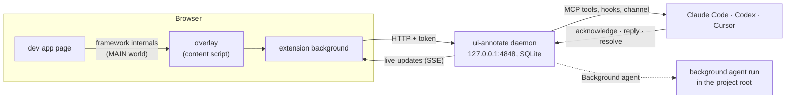

# ui-annotate

**Point at the UI, tell your coding agent what is wrong.** A browser extension for Chrome and
Firefox: click an element of your running dev app, write a note, and Claude Code, Codex or Cursor
receives the selector, DOM context, component name and the exact source `file:line`. The agent
answers and resolves right on the page.

English · [Русский](README.ru.md)


## Why

Describing UI problems in a chat is slow and lossy: "the grey button under the price, no, the
other one". Screenshots carry no code location, so the agent greps for text and guesses. ui-annotate
attaches what the agent needs to every note: which element, which component, which line of which
file. Nothing gets installed into your app: the extension reads framework internals of the dev build.

## Features

- **Element, text, multi-select and area annotations** with intent (fix, change, question, approve)
  and severity.
- **Source location without app changes** for Vue, React 18/19, Svelte 4/5, Angular and Solid; exact
  template lines with common build plugins (see [Source location](#source-location)).
- **Two-way thread on the page**: the agent acknowledges, asks questions, resolves with a summary;
  you reply in the overlay.
- **Agent integrations**: an MCP server (stdio and Streamable HTTP), hooks that put open annotations
  into the agent's context and keep it from stopping while work is open, a Claude Code plugin with a
  live channel.
- **Delivery modes per site**: new annotations go to every agent session of the project, straight
  into one running Claude Code session you pick (**Live session**), or to a background `claude`,
  `codex` or `cursor-agent` run limited to reading and editing (**Background agent**).
- **Project root detection**: the daemon finds the repository behind `localhost:PORT` by itself, so
  paths are relative and annotations reach only the agent working in that repository.
- **Local only**: one daemon on `127.0.0.1`, SQLite storage, token pairing done automatically.

## How it works



## Quick start

> Want your agent to set it up? Give it [docs/agents/install.md](docs/agents/install.md).

Requirements: Node.js ≥ 22.13 (the daemon uses `node:sqlite`), pnpm 9, Chrome ≥ 116 or Firefox ≥ 128.

**1. Build**

```sh
git clone https://github.com/AnarchyGhost/ui-annotate.git
cd ui-annotate
pnpm install
pnpm build          # extension → apps/extension/.output/{chrome-mv3,firefox-mv3}
```

**2. Load the extension**

- **Chrome**: `chrome://extensions` → Developer mode → *Load unpacked* →
  `apps/extension/.output/chrome-mv3`.
- **Firefox**: `about:debugging#/runtime/this-firefox` → *Load Temporary Add-on* →
  `apps/extension/.output/firefox-mv3/manifest.json`. A temporary add-on is removed when Firefox
  restarts; Firefox Developer Edition, Nightly and forks such as Zen keep an unsigned build installed
  with `xpinstall.signatures.required = false`.

**3. Connect your agent** (any combination)

```sh
# Claude Code: MCP server, skill, hooks and the channel in one plugin
claude plugin marketplace add "$PWD"
claude plugin install ui-annotate@ui-annotate-local

# Codex: MCP server in ~/.codex/config.toml, hooks in ~/.codex/hooks.json
pnpm exec ui-annotate init codex --write     # then approve the hooks once in Codex: /hooks

# Cursor: .cursor/mcp.json and .cursor/hooks.json of the project you run it in
cd /path/to/your/app && /path/to/ui-annotate/node_modules/.bin/ui-annotate init cursor --write
```

`init` writes the absolute path of the Node.js that runs it, so run it with Node ≥ 22.13 first in
`PATH`. The daemon starts by itself with the first MCP connection; `pnpm exec ui-annotate serve` runs
it by hand.

**4. Annotate.** Open your dev app, click the extension icon (or press `Ctrl/Cmd+Shift+F`), turn on
annotation mode (`Ctrl/Cmd+Shift+1`), click an element and type the note. Enter saves.

**5. Let the agent work.** Ask it to "handle the UI feedback", or simply keep working: the hooks
show open annotations in its context. Replies and resolutions appear on the page live.


## What the agent receives

`get_pending` returns a markdown block per annotation plus the same data as JSON. The first line is
the location the agent opens first:

```markdown
`src/components/PlanCard.vue:17:7` `<PlanCard>` — #1 fix/important [pending] id=a_vOPD0BMk

> Upgrade is the main action here: make it primary, like Invite

- element: `button "Upgrade plan"`
  selector: `[data-testid="upgrade"]`
  path: `main.content > div.grid > section.card > div.actions > button[data-testid=upgrade]`
  text: "Upgrade plan"
  parents: App (src/App.vue)
- page: http://127.0.0.1:5180/ (1280×800)
```

The agent works through annotations with MCP tools and the thread shows up in the overlay:


### MCP tools

| Tool | Parameters | Result |
|---|---|---|
| `list_sessions` | — | pages with open and total counts |
| `link_page` | `url`, `projectRoot?` | ties the page to the agent's repository (or the given absolute path) |
| `get_pending` | `sessionId?` | open (pending or acknowledged) annotations; all pages without `sessionId` |
| `get_annotation` | `id` | one annotation with its thread |
| `acknowledge` | `id` | status `acknowledged` |
| `reply` | `id`, `message` | agent message in the thread |
| `resolve` | `id`, `summary` | status `resolved`, summary in the thread |
| `dismiss` | `id`, `reason` | status `dismissed`, reason in the thread |
| `watch_annotations` | `sessionId?`, `timeoutSeconds` ≤ 25 | batch of new annotations or `{"timeout":true}` |

The same tools are served over Streamable HTTP at `http://127.0.0.1:4848/mcp` with the token as
`Authorization: Bearer` (`pnpm exec ui-annotate token`). `watch_annotations` keeps a cursor per MCP
session, so annotations created while the agent was busy come with the next call.

### Hooks and the channel

- **Claude Code and Codex**: `SessionStart` and `UserPromptSubmit` add a digest of open annotations
  (≤ 10 000 characters) and stay silent when there are none; `Stop` blocks the end of a turn while
  annotations of this project are open, once (`stop_hook_active`).
- **Cursor**: the digest comes from `sessionStart` (`beforeSubmitPrompt` cannot add context); `stop`
  sends a follow-up message at most twice.
- **Claude Code channel** (research preview, interactive sessions):
  `claude --dangerously-load-development-channels plugin:ui-annotate@ui-annotate-local` delivers each
  new annotation as a `<channel source="...ui-annotate...">` message without typing anything.

The daemon is shared by all projects. Hooks and the channel show annotations of pages whose project
root contains the agent's working directory; pages without a root appear only as a count and never
block. Annotations a site sends to another Live session or a background run appear only as a count.

## Delivery modes

Popup → *This site* → **New annotations go to** decides who gets each new annotation of the site:

| Mode | Who gets it |
|---|---|
| Off | every agent session of the project: hooks and the channel, as above |
| Live session | one running Claude Code session picked in the popup, through its channel |
| Background agent | a background agent run of the daemon; live sessions do not see it until the run fails or asks |

### Live session

Start Claude Code in the project folder with the channel:
`claude --dangerously-load-development-channels plugin:ui-annotate@ui-annotate-local`. The popup
lists the running sessions of the page's project (name from `/rename`, idle or busy, PID); pick one.
Each new annotation arrives in that session as a channel message, and only its hooks show it and
block Stop.

- A restarted `claude` gets a new PID. When it is the only session of the project, the site and the
  waiting annotations move to it by themselves; with several, pick one again.
- With no session running, the annotation stays pending with a note in the thread.
- A session started without the channel flag drops channel messages silently. After 60 s without a
  reaction the thread says so once.

Channels are a research preview of Claude Code: interactive sessions only, the flag is required for
plugins outside Anthropic's allowlist.

### Background agent

**Background agent** hands every new annotation of the site to a background agent run, with no agent
session open. Pick the agent and a delay: the run starts after that many quiet seconds, so notes left
in a row go into one run.


The daemon starts the CLI in the page's project root and reports in the thread: "working on it",
then resolved or dismissed with the agent's summary, a question as a reply, or the failure reason.
An annotation still open after the run goes back to the agent sessions of the project. One run per
project at a time.

| Agent | Command | Limits |
|---|---|---|
| claude | `claude -p --permission-mode acceptEdits --allowedTools Read,Edit,Write,Glob,Grep` | read and edit tools only; Bash, web and MCP tools are denied |
| codex | `codex exec --sandbox workspace-write --skip-git-repo-check -C <root>` | Codex has no switch for its shell tool: commands run in the sandbox, writes only inside the project, no network |
| cursor | `cursor-agent -p --force --sandbox enabled --trust --workspace <root>` | edits applied; shell commands run in Cursor's sandbox |

The CLIs are looked up in the daemon's `PATH`; `UI_ANNOTATE_CLAUDE_BIN`, `UI_ANNOTATE_CODEX_BIN` and
`UI_ANNOTATE_CURSOR_BIN` override them. A run stops after 15 minutes. The agent edits your code with
no review step, so turn the mode on for projects under version control.

## Project root

The project root of a page makes source paths relative and scopes its annotations to agent sessions
in that folder. It is found without setup, in this order of precedence:

1. the *Project root* field of the popup (manual override);
2. `link_page(url)` called by an agent: the repository it runs in (the Claude Code skill calls it
   after starting a dev server);
3. the dev server behind a localhost page: the process listening on the port (`/proc` on Linux,
   `lsof` on macOS), its working directory, lifted to the git top level;
4. absolute source paths in the first annotation, lifted to the git top level and accepted only
   with a project marker (`package.json`, `angular.json`, …).

The home directory, the file system root and processes outside home (proxies, containers) never
become a root. The popup shows what was detected and how.

## Using the overlay

| Action | Default shortcut |
|---|---|
| Show / hide everything on the page | `Ctrl/Cmd+Shift+F` |
| Annotation mode on/off | `Ctrl/Cmd+Shift+1` |
| Markers on/off | `Ctrl/Cmd+Shift+2` |
| Resolved and dismissed annotations on/off | `Ctrl/Cmd+Shift+3` |

Rebind them in the browser: *Change shortcuts* in the popup opens the shortcut settings.

| In annotation mode | How |
|---|---|
| Annotate an element | click it |
| Several elements | Ctrl/Cmd+click each, then Enter |
| Text | select it with the mouse |
| Area | drag on a non-text area |
| Save / newline / cancel | Enter / Shift+Enter / Esc |

Markers follow their element and fall back to the stored position with a dashed border when it is
gone. *Load on every visit* in the popup injects the overlay at page load; origins other than
`localhost` and `127.0.0.1` ask for the host permission first.

## Source location

Verified on the dev servers in [`fixtures/`](fixtures) by `apps/extension/e2e/resolve.spec.ts`:

| Framework | Component | File | Line |
|---|---|---|---|
| Vue 3 | `__vueParentComponent` | `__file` | template line with [vite-plugin-vue-inspector](https://github.com/webfansplz/vite-plugin-vue-inspector) |
| React 18 (@vitejs/plugin-react 4) | owner fiber | `_debugSource` | JSX line, corrected through the module source map |
| React 19 (@vitejs/plugin-react 6) | owner fiber | `_debugStack` + source map | JSX line |
| Svelte 4 / 5 | file name | `__svelte_meta` | template line |
| Angular 22 | component class | `ɵcmp.debugInfo.filePath` | line of the class declaration |
| Solid | — | with solid-devtools `data-source-loc` | JSX line |

Build-plugin attributes take priority: `data-insp-path` (code-inspector-plugin), vite-plugin-vue-inspector,
`data-locatorjs`, `data-source-loc`. Without any source the annotation still carries the DOM context
and a reason: `production-build`, `no-framework` or `no-line`.

## Security model

The daemon listens on `127.0.0.1` only and checks every request:

1. `Host` is `127.0.0.1:<port>` or `localhost:<port>` (DNS rebinding).
2. `Origin`, when present, is the extension origin: a web page cannot call the API even with the
   token. Without `Origin`, `Sec-Fetch-Site` must be absent, `none` or `same-origin`.
3. `Authorization: Bearer <token>` (other local processes and extensions).

`POST /pair` hands the token only to the extension: the fixed Chrome ID, or the first Firefox install
that pairs (`pnpm exec ui-annotate unpair` resets it). Overlay inputs accept only trusted user events,
so page scripts cannot write annotations. Page-derived text reaches the agent flattened and marked as
data, and source paths outside the project root are dropped.

## Demo

[`examples/demo`](examples/demo) is the Vue app of the screenshots. `pnpm screenshots` (after
`pnpm build`) starts it with a test daemon, drives the extension in Chrome for Testing and writes
`docs/images/*.png`.

## Development

See [AGENTS.md](AGENTS.md): layout, commands, conventions and how to verify a change. It is written
for coding agents and works as a contributor guide too.

## Status

Early stage. Not published to the Chrome Web Store, addons.mozilla.org or npm yet: install from
source as above. Tested on Linux with Chrome for Testing 151–156, Google Chrome 155,
Firefox 158 and Zen 1.23; the macOS `lsof` path of project root detection is untested.

## License

[MIT](LICENSE)
