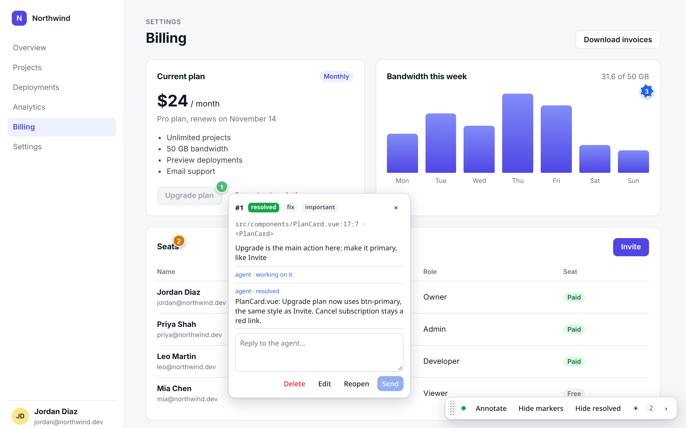
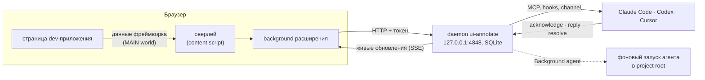
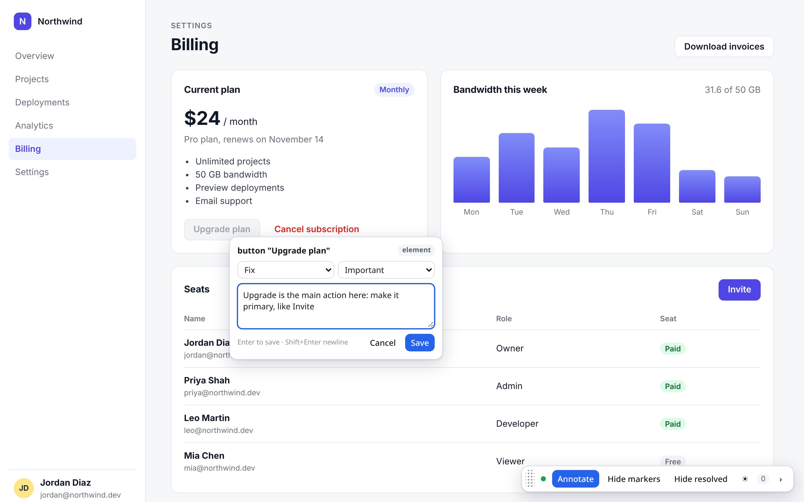
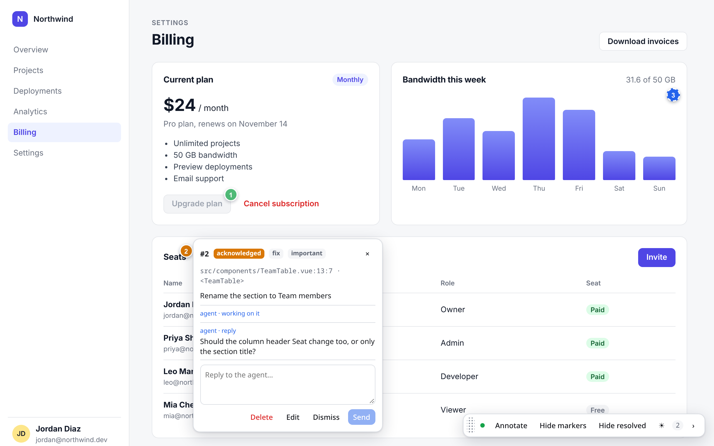
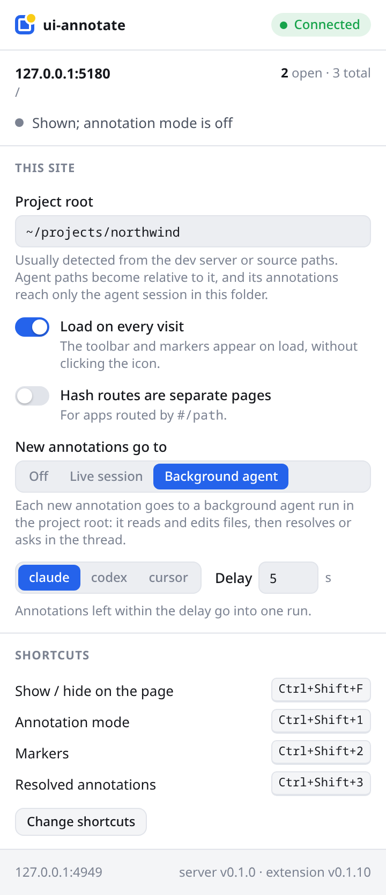

# ui-annotate

**Ткните в интерфейс и скажите агенту, что с ним не так.** Расширение для Chrome и Firefox: кликаете
по элементу запущенного dev-приложения, пишете замечание, и Claude Code, Codex или Cursor получает
селектор, DOM-контекст, имя компонента и точный `file:line` в исходниках. Агент отвечает и закрывает
замечание прямо на странице.

[English](README.md) · Русский



## Зачем

Описывать проблемы интерфейса в чате долго и неточно: «серая кнопка под ценой, нет, другая».
Скриншот не несёт адреса в коде, агент ищет текст грепом и угадывает. ui-annotate прикладывает к
каждому замечанию то, что нужно агенту: какой элемент, какой компонент, какая строка какого файла.
В приложение ничего ставить не нужно: расширение читает служебные данные фреймворка из dev-сборки.

## Возможности

- **Замечания к элементу, тексту, группе элементов и области** с типом (fix, change, question,
  approve) и важностью.
- **Место в исходниках без правок приложения** для Vue, React 18/19, Svelte 4/5, Angular и Solid;
  точная строка шаблона с популярными build-плагинами (см. [Место в исходниках](#место-в-исходниках)).
- **Переписка на странице**: агент берёт замечание в работу, задаёт вопросы, закрывает с описанием;
  вы отвечаете в оверлее.
- **Интеграции с агентами**: MCP-сервер (stdio и Streamable HTTP), hooks, которые кладут открытые
  замечания в контекст агента и не дают ему закончить ход при открытых замечаниях, плагин Claude Code
  с живым каналом.
- **Режимы доставки для сайта**: новые замечания уходят всем сессиям агентов проекта, прямо в одну
  выбранную живую сессию Claude Code (**Live session**) либо в фоновый запуск `claude`, `codex` или
  `cursor-agent` с правами только на чтение и правку (**Background agent**).
- **Определение project root**: daemon сам находит репозиторий за `localhost:PORT`, пути становятся
  относительными, а замечания попадают только агенту, работающему в этом репозитории.
- **Всё локально**: один daemon на `127.0.0.1`, хранение в SQLite, токен привязывается автоматически.

## Как это устроено



## Быстрый старт

> Хотите, чтобы агент поставил всё сам? Дайте ему [docs/agents/install.md](docs/agents/install.md).

Нужны Node.js ≥ 22.13 (daemon использует `node:sqlite`), pnpm 9, Chrome ≥ 116 или Firefox ≥ 128.

**1. Сборка**

```sh
git clone https://github.com/AnarchyGhost/ui-annotate.git
cd ui-annotate
pnpm install
pnpm build          # расширение → apps/extension/.output/{chrome-mv3,firefox-mv3}
```

**2. Установка расширения**

- **Chrome**: `chrome://extensions` → Developer mode → *Load unpacked* →
  `apps/extension/.output/chrome-mv3`.
- **Firefox**: `about:debugging#/runtime/this-firefox` → *Load Temporary Add-on* →
  `apps/extension/.output/firefox-mv3/manifest.json`. Временное дополнение пропадает после
  перезапуска Firefox; Firefox Developer Edition, Nightly и форки вроде Zen держат неподписанную
  сборку с `xpinstall.signatures.required = false`.

**3. Подключение агента** (в любой комбинации)

```sh
# Claude Code: MCP-сервер, skill, hooks и channel одним плагином
claude plugin marketplace add "$PWD"
claude plugin install ui-annotate@ui-annotate-local

# Codex: MCP-сервер в ~/.codex/config.toml, hooks в ~/.codex/hooks.json
pnpm exec ui-annotate init codex --write     # затем один раз подтвердите hooks в Codex: /hooks

# Cursor: .cursor/mcp.json и .cursor/hooks.json проекта, в котором его запускаете
cd /path/to/your/app && /path/to/ui-annotate/node_modules/.bin/ui-annotate init cursor --write
```

`init` записывает абсолютный путь к Node.js, которым запущен, поэтому запускайте его, когда первым в
`PATH` стоит Node ≥ 22.13. Daemon поднимается сам при первом MCP-подключении; вручную —
`pnpm exec ui-annotate serve`.

**4. Замечание.** Откройте dev-приложение, кликните по иконке расширения (или `Ctrl/Cmd+Shift+F`),
включите режим замечаний (`Ctrl/Cmd+Shift+1`), кликните по элементу и напишите текст. Enter сохраняет.

**5. Работа агента.** Попросите его «разобрать замечания из браузера» или просто продолжайте работу:
hooks покажут открытые замечания в контексте. Ответы и закрытия появляются на странице сразу.



## Что получает агент

`get_pending` отдаёт markdown-блок на каждое замечание и те же данные в JSON. Первая строка — место,
которое агент открывает первым:

```markdown
`src/components/PlanCard.vue:17:7` `<PlanCard>` — #1 fix/important [pending] id=a_vOPD0BMk

> Upgrade is the main action here: make it primary, like Invite

- element: `button "Upgrade plan"`
  selector: `[data-testid="upgrade"]`
  path: `main.content > div.grid > section.card > div.actions > button[data-testid=upgrade]`
  text: "Upgrade plan"
  parents: App (src/App.vue)
- page: http://127.0.0.1:5180/ (1280×800)
```

Агент разбирает замечания MCP-инструментами, переписка видна в оверлее:



### MCP-инструменты

| Инструмент | Параметры | Результат |
|---|---|---|
| `list_sessions` | — | страницы с числом открытых и всех замечаний |
| `link_page` | `url`, `projectRoot?` | привязывает страницу к репозиторию агента (или к указанному абсолютному пути) |
| `get_pending` | `sessionId?` | открытые замечания (pending и acknowledged); без `sessionId` — по всем страницам |
| `get_annotation` | `id` | одно замечание с перепиской |
| `acknowledge` | `id` | статус `acknowledged` |
| `reply` | `id`, `message` | сообщение агента в переписке |
| `resolve` | `id`, `summary` | статус `resolved`, описание правки в переписке |
| `dismiss` | `id`, `reason` | статус `dismissed`, причина в переписке |
| `watch_annotations` | `sessionId?`, `timeoutSeconds` ≤ 25 | пачка новых замечаний или `{"timeout":true}` |

Те же инструменты доступны по Streamable HTTP на `http://127.0.0.1:4848/mcp` с токеном в
`Authorization: Bearer` (`pnpm exec ui-annotate token`). `watch_annotations` хранит курсор на каждую
MCP-сессию, поэтому замечания, созданные пока агент был занят, придут следующим вызовом.

### Hooks и channel

- **Claude Code и Codex**: `SessionStart` и `UserPromptSubmit` добавляют сводку открытых замечаний
  (≤ 10 000 символов) и молчат, когда их нет; `Stop` один раз блокирует завершение хода, пока
  замечания этого проекта открыты (`stop_hook_active`).
- **Cursor**: сводка приходит из `sessionStart` (`beforeSubmitPrompt` не умеет добавлять контекст);
  `stop` отправляет follow-up не больше двух раз.
- **Channel Claude Code** (research preview, интерактивные сессии):
  `claude --dangerously-load-development-channels plugin:ui-annotate@ui-annotate-local` доставляет
  каждое новое замечание сообщением `<channel source="...ui-annotate...">` без ввода с вашей стороны.

Daemon общий для всех проектов. Hooks и channel показывают замечания страниц, чей project root
содержит рабочую папку агента; страницы без root видны только счётчиком и ход не блокируют.
Замечания, которые сайт отправил другой Live session или фоновому запуску, тоже видны только счётчиком.

## Режимы доставки

Popup → *This site* → **New annotations go to** определяет, кто получает новое замечание сайта:

| Режим | Кто получает |
|---|---|
| Off | все сессии агентов проекта: hooks и channel, как описано выше |
| Live session | одна запущенная сессия Claude Code, выбранная в popup, через её channel |
| Background agent | фоновый запуск агента от daemon'а; живые сессии его не видят, пока запуск не упал или не задал вопрос |

### Live session

Запустите Claude Code в папке проекта с channel:
`claude --dangerously-load-development-channels plugin:ui-annotate@ui-annotate-local`. Popup
показывает запущенные сессии проекта страницы (имя из `/rename`, idle или busy, PID); выберите одну.
Каждое новое замечание приходит в эту сессию сообщением channel, и только её hooks показывают его и
блокируют Stop.

- Перезапущенный `claude` получает новый PID. Если в проекте он единственный, сайт и ждущие замечания
  переезжают на него сами; при нескольких сессиях выберите заново.
- Пока ни одна сессия не запущена, замечание ждёт в статусе pending с пометкой в переписке.
- Сессия без флага channel молча теряет сообщения. Если за 60 с реакции нет, переписка один раз
  говорит об этом.

Channels в Claude Code — research preview: только интерактивные сессии, а `--channels` принимает
только плагины из allowlist. По умолчанию ui-annotate в него не входит, отсюда флаг разработки и
диалог подтверждения при каждом запуске. Чтобы разрешить плагин один раз, добавьте его в файл
[managed settings](https://code.claude.com/docs/en/settings) (в Linux
`/etc/claude-code/managed-settings.json`, нужен root; проверено на тарифе Max без организации):

```json
{
  "channelsEnabled": true,
  "allowedChannelPlugins": [{ "marketplace": "ui-annotate-local", "plugin": "ui-annotate" }]
}
```

После этого хватает `claude --channels plugin:ui-annotate@ui-annotate-local`; набор сокращает alias
в shell. Managed settings приоритетнее пользовательских во всех сессиях; эти два ключа касаются
только channels.

### Background agent

**Background agent** отдаёт каждое новое замечание сайта фоновому запуску агента, открытая сессия
агента не нужна. Выберите агента и задержку: запуск стартует после стольких секунд тишины, поэтому
замечания подряд уходят в один запуск.



Daemon запускает CLI в project root страницы и пишет ход работы в переписку: «working on it», затем
закрытие или отклонение с описанием от агента, вопрос ответом, либо причина сбоя. Замечание, которое
осталось открытым после запуска, возвращается сессиям агентов проекта. На проект одновременно идёт
один запуск.

| Агент | Команда | Ограничения |
|---|---|---|
| claude | `claude -p --permission-mode acceptEdits --allowedTools Read,Edit,Write,Glob,Grep` | только инструменты чтения и правки; Bash, веб и MCP запрещены |
| codex | `codex exec --sandbox workspace-write --skip-git-repo-check -C <root>` | shell у Codex не отключается: команды идут в песочнице, запись только внутри проекта, без сети |
| cursor | `cursor-agent -p --force --sandbox enabled --trust --workspace <root>` | правки применяются; shell-команды в песочнице Cursor |

CLI ищутся в `PATH` daemon'а; `UI_ANNOTATE_CLAUDE_BIN`, `UI_ANNOTATE_CODEX_BIN` и
`UI_ANNOTATE_CURSOR_BIN` переопределяют пути. Запуск останавливается через 15 минут. Агент правит код
без ревью, поэтому включайте режим для проектов под системой контроля версий.

## Project root

Project root страницы делает пути в исходниках относительными и направляет её замечания только в
сессии агентов из этой папки. Определяется без настройки, в порядке приоритета:

1. поле *Project root* в popup (ручное значение);
2. `link_page(url)` от агента: репозиторий, в котором он работает (skill Claude Code вызывает его
   после запуска dev-сервера);
3. dev-сервер за localhost-страницей: процесс, слушающий порт (`/proc` на Linux, `lsof` на macOS),
   его рабочая папка, поднятая до корня git;
4. абсолютные пути исходников в первом замечании, поднятые до корня git и принятые только при наличии
   маркера проекта (`package.json`, `angular.json`, …).

Домашняя папка, корень файловой системы и процессы вне домашней папки (прокси, контейнеры) root не
становятся. Popup показывает, что найдено и каким способом.

## Работа с оверлеем

| Действие | Сочетание по умолчанию |
|---|---|
| Показать / скрыть всё на странице | `Ctrl/Cmd+Shift+F` |
| Режим замечаний вкл/выкл | `Ctrl/Cmd+Shift+1` |
| Маркеры вкл/выкл | `Ctrl/Cmd+Shift+2` |
| Закрытые и отклонённые замечания вкл/выкл | `Ctrl/Cmd+Shift+3` |

Сочетания меняются в браузере: *Change shortcuts* в popup открывает их настройки.

| В режиме замечаний | Как |
|---|---|
| Замечание к элементу | клик по нему |
| Несколько элементов | Ctrl/Cmd+клик по каждому, затем Enter |
| Текст | выделить мышью |
| Область | протянуть мышью по месту без текста |
| Сохранить / новая строка / отмена | Enter / Shift+Enter / Esc |

Маркеры следуют за своим элементом, а когда его нет, остаются на сохранённой позиции с пунктирной
рамкой. *Load on every visit* в popup подключает оверлей при загрузке страницы; для адресов кроме
`localhost` и `127.0.0.1` браузер сначала спросит доступ к сайту.

## Место в исходниках

Проверено на dev-серверах из [`fixtures/`](fixtures) тестом `apps/extension/e2e/resolve.spec.ts`:

| Фреймворк | Компонент | Файл | Строка |
|---|---|---|---|
| Vue 3 | `__vueParentComponent` | `__file` | строка шаблона с [vite-plugin-vue-inspector](https://github.com/webfansplz/vite-plugin-vue-inspector) |
| React 18 (@vitejs/plugin-react 4) | owner fiber | `_debugSource` | строка JSX, поправленная по source map модуля |
| React 19 (@vitejs/plugin-react 6) | owner fiber | `_debugStack` + source map | строка JSX |
| Svelte 4 / 5 | имя файла | `__svelte_meta` | строка шаблона |
| Angular 22 | класс компонента | `ɵcmp.debugInfo.filePath` | строка объявления класса |
| Solid | — | с solid-devtools `data-source-loc` | строка JSX |

Атрибуты build-плагинов в приоритете: `data-insp-path` (code-inspector-plugin), vite-plugin-vue-inspector,
`data-locatorjs`, `data-source-loc`. Без исходников замечание всё равно несёт DOM-контекст и причину:
`production-build`, `no-framework` или `no-line`.

## Безопасность

Daemon слушает только `127.0.0.1` и проверяет каждый запрос:

1. `Host` равен `127.0.0.1:<port>` или `localhost:<port>` (DNS rebinding).
2. `Origin`, если есть, равен origin расширения: веб-страница не вызовет API даже с токеном. Без
   `Origin` заголовок `Sec-Fetch-Site` должен отсутствовать либо быть `none` или `same-origin`.
3. `Authorization: Bearer <token>` (другие локальные процессы и расширения).

`POST /pair` отдаёт токен только расширению: фиксированному ID в Chrome или первой установке в
Firefox, которая привязалась (`pnpm exec ui-annotate unpair` сбрасывает привязку). Поля оверлея
принимают только настоящие действия пользователя, поэтому скрипты страницы не напишут замечание за
вас. Текст со страницы доходит до агента в нормализованном виде с пометкой «данные», пути вне project
root отбрасываются.

## Демо

[`examples/demo`](examples/demo) — Vue-приложение со скриншотов. `pnpm screenshots` (после
`pnpm build`) поднимает его с тестовым daemon, проходит сценарий в Chrome for Testing и пишет
`docs/images/*.png`.

## Разработка

См. [AGENTS.md](AGENTS.md): структура, команды, соглашения и проверка изменений. Файл написан для
coding-агентов и годится как гайд для контрибьюторов.

## Статус

Ранняя стадия. В Chrome Web Store, addons.mozilla.org и npm пока не опубликовано: установка из
исходников, как описано выше. Проверено на Linux с Chrome for Testing 151–156, Google Chrome 155,
Firefox 158 и Zen 1.23; путь определения project root через `lsof` на macOS не проверен.

## Лицензия

[MIT](LICENSE)
